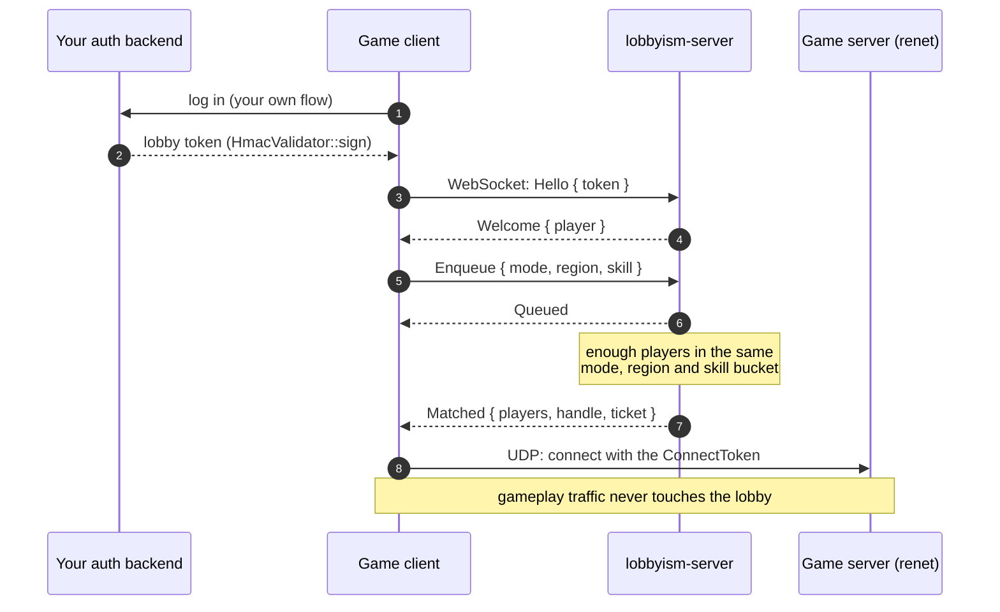
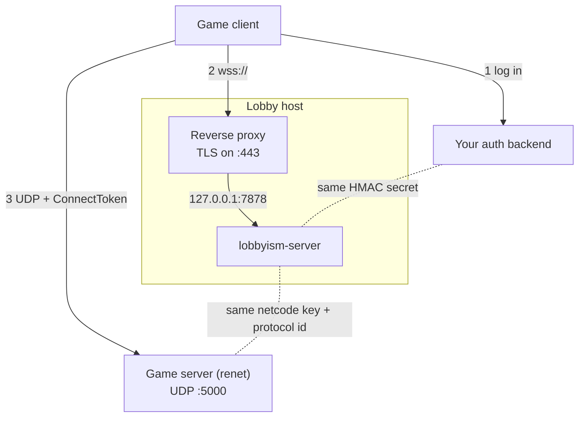

# lobbyism

Lobbies and matchmaking for Rust games: players find each other here, then connect with whatever transport the game already uses.

Rust has good transports (renet, quinn, matchbox, ggrs), but not so much on getting players together before they connect: there is no counterpart to Steam lobbies or a small master server you can embed. lobbyism is an attempt at that missing piece, and it deliberately stops where the existing crates start: when a match is formed, every player gets a connection ticket for the transport (a renet `ConnectToken`, or a matchbox room), and the lobby never sees a single gameplay packet.

In case these names are new: [renet](https://github.com/lucaspoffo/renet) is a client-server networking library for games that sends reliable and unreliable messages over UDP, and its `renet_netcode` transport implements the [netcode.io](https://github.com/mas-bandwidth/netcode) protocol, in which a backend hands each player an encrypted `ConnectToken` and the game server only lets in clients that present one (lobbyism plays that backend). [matchbox](https://github.com/johanhelsing/matchbox) connects players peer-to-peer over WebRTC, natively and in the browser, with a small signaling server introducing the peers to each other, and [GGRS](https://github.com/gschup/ggrs) is rollback netcode that commonly runs on top of it.

This is a young project. Everything lives in memory, so a restart forgets all lobbies and queues.

## How it fits together

A player who queues for a match goes through this, end to end:



Lobbies end the same way: instead of `Enqueue`, players create or join a lobby, mark themselves ready, and the host's `StartMatch` produces the same `Matched` message for every member.

| Crate | What it is |
|---|---|
| `lobbyism` | The wire protocol (message types, JSON-encoded and tagged by `type`) and, behind the default `client` feature, an async client (`connect`, `send`, `recv`) on `tokio-tungstenite-wasm`, so the same code builds natively and for `wasm32-unknown-unknown`. |
| `lobbyism-server` | The lobby and queue state machine (`Core`), the WebSocket front end (`serve`), token validation and ticket issuers, plus a `lobbyism-server` binary. It uses `lobbyism` with `default-features = false`, i.e. the protocol without the client. |

## Try it

The example starts a renet game server, the lobby server and two clients in one process; both clients queue for a duel, get matched, and connect to the game server with their tickets:

```shell
cargo run -p lobbyism --example renet_match
```

```text
lobby matched players [1002, 1001] into match 1
game server: player 1001 joined match 1
game server: player 1002 joined match 1
game client 1001: server says "welcome 1001"
game client 1002: server says "welcome 1002"
both players connected over renet
```

## How do I use this?

### As a game developer

lobbyism touches four parts of a multiplayer setup, and two of them are yours already:

- Your auth backend logs players in however it likes and hands each one a lobby token, created with `HmacValidator::sign` (or anything else, if you put your own `TokenValidator` in front of the server).
- Your game client uses `lobbyism` to queue or meet in a lobby, waits for `Matched`, and passes the ticket to renet or matchbox.
- Your dedicated game server (renet only) runs `ServerAuthentication::Secure` with the same netcode key and protocol id as the lobby, and reads the match id from each connection's user data.
- The lobby server is either the `lobbyism-server` binary or the library embedded in a binary of yours, e.g. to add a host-migration hook or a different ticket issuer.

On the client side, queueing looks like this:

```rust
use lobbyism::{ClientMsg, LobbyClient, ServerMsg, Ticket};

let mut client = LobbyClient::connect("wss://lobby.example.com", &token).await?;
client.send(ClientMsg::Enqueue { mode: "duel".into(), region: "eu".into(), skill: 1200 }).await?;
while let Some(msg) = client.recv().await? {
    if let ServerMsg::Matched(m) = msg {
        // m.players is the match in handle order, m.handle is our index in it
        if let Ticket::Netcode { connect_token, .. } = m.ticket {
            // renet_netcode::ConnectToken::read(&mut connect_token.as_slice())
        }
        break;
    }
}
```

Lobbies work the same way with `CreateLobby`, `JoinLobby`, `SetMetadata`, `SetReady`, `StartMatch` and `LeaveLobby`; every member receives the full lobby state after each change, and a `HostMigrated` message when the host leaves and the next member in join order takes over.

Keep calling `recv()` for as long as the connection should stay open, e.g. in its own task: polling is what answers the server's pings, and a client that stays silent for 60 seconds is dropped.

Embedding the server instead of running the binary looks like this:

```rust
use lobbyism_server::{serve, Config, Core, HmacValidator, NetcodeIssuer};

let issuer = NetcodeIssuer {
    protocol_id: 7,
    private_key,                       // [u8; 32], shared with the game server
    server_addresses: vec!["203.0.113.10:5000".parse()?],
    expire_seconds: 30,
    timeout_seconds: 15,
};
let core = Core::new(Config::default(), issuer)
    .on_host_migration(Box::new(|lobby, old, new| println!("lobby {lobby}: {old} -> {new}")));
let listener = tokio::net::TcpListener::bind("127.0.0.1:7878").await?;
serve(listener, core, HmacValidator::new(secret)?).await?;
```

`Config` holds the queue modes, regions, skill bucket width (100 by default), the largest allowed lobby (16) and the metadata budget per lobby (4096 bytes of keys and values).

### As an operator

The binary is configured through environment variables:

| Variable | Meaning | Default |
|---|---|---|
| `LOBBYISM_BIND` | Listen address | `127.0.0.1:7878` |
| `LOBBYISM_HMAC_SECRET` | Secret for client tokens, at least 32 bytes | required |
| `LOBBYISM_NETCODE_KEY` | netcode private key shared with the game server, 64 hex characters | required |
| `LOBBYISM_PROTOCOL_ID` | netcode protocol id of your game | required |
| `LOBBYISM_GAME_SERVERS` | Comma-separated public game server addresses, 1 to 32 | required |
| `LOBBYISM_MODES` | Queue modes and players per match (at least 1), e.g. `duel=2,squad=4` | `duel=2` |
| `LOBBYISM_REGIONS` | Comma-separated regions clients may queue in | `eu,us` |

For a local run:

```shell
LOBBYISM_HMAC_SECRET="$(openssl rand -hex 32)" \
LOBBYISM_NETCODE_KEY="$(openssl rand -hex 32)" \
LOBBYISM_PROTOCOL_ID=7 \
LOBBYISM_GAME_SERVERS=127.0.0.1:5000 \
cargo run -p lobbyism-server
```

The binary also reads a `.env` file from the working directory (or one of its parents) before it starts, so `cp .env.example .env`, filling in the two secrets and `cargo run -p lobbyism-server` works too. Variables that are already set in the environment win over the file, and a `.env` that doesn't parse stops the server instead of being skipped. Building with `--no-default-features --features cli` leaves this out, for deployments where the environment comes from the orchestrator anyway.

In a real deployment the game server needs the same netcode key and protocol id, and your auth backend the same HMAC secret, so all three come from your secret store rather than a fresh `openssl` call. The netcode key and the HMAC secret must never reach a client.

#### Where to host it

The server is one small process with all state in memory: it needs little CPU and memory, but exactly one instance per game, as two instances would not see each other's lobbies or queues (and a restart drops everything, so clients should reconnect and re-queue). A small VM or a single container, close to most of your players, does the job. Serverless platforms that cut requests after a few seconds or minutes don't fit, since every client holds one WebSocket open for as long as it is looking for a game.

A typical setup, with the lobby behind a TLS proxy and the secrets each pair of services has to share:



#### Network things to be aware of

- The server speaks plain `ws://`. Put a reverse proxy (Caddy, nginx, Traefik, a cloud load balancer) in front that terminates TLS and forwards WebSocket upgrades, and keep `LOBBYISM_BIND` on `127.0.0.1` behind it; browsers on an `https://` page only allow `wss://` anyway.
- The server pings every client every 20 seconds and drops a client that sends nothing back (not even a pong) for 60 seconds, which is how players whose network vanished leave their lobby or queue. That ping traffic also keeps proxies happy: default idle timeouts such as nginx's 60 s `proxy_read_timeout` are fine, just don't set them below about 30 seconds.
- `LOBBYISM_GAME_SERVERS` ends up inside every `ConnectToken`, and the renet server only accepts a token that lists one of its own `public_addresses`. So it has to be the address clients actually reach (not `0.0.0.0`, not a private IP behind NAT), and it has to match the game server's configuration exactly. The game server's UDP port needs to be open separately; the lobby only needs its TCP port.
- Lobby tokens and `ConnectToken`s both carry expiry times, and a `ConnectToken` has to be used within `expire_seconds` (30 in the binary). Keep the lobby, the game server and your auth backend on NTP, or players will get rejected for no visible reason.
- Every connected player holds one file descriptor, and many Linux systems allow only 1024 per process by default. Raise the limit for the lobby (`LimitNOFILE=` in a systemd unit, `ulimit -n` otherwise) well above the number of players you expect; when it runs out, new connections are refused until others close.
- The server caps frames at 64 KiB, closes connections that don't authenticate within 10 seconds and drops clients that stop reading, but it has no per-IP connection or rate limits. Those belong in the proxy.
- A matchbox ticket points at your matchbox_server, which you host separately; peers still need STUN (and for some networks TURN) to reach each other, which lobbyism doesn't provide (see "NAT traversal" below).

## Tickets

For renet / netcode.io, `NetcodeIssuer` generates a real `ConnectToken` per player, encrypted with the private key the lobby shares with the game server, which then runs `ServerAuthentication::Secure` with the same key. The renet client id is the player id, and the first eight bytes of the token's user data hold the match id (little-endian), so the game server can tell which connections belong to which match.

For matchbox / GGRS, `MatchboxIssuer` sends every player of a match the same signaling room URL with `?next=N`, so matchbox_server groups exactly those players; the player list in the match doubles as the GGRS peer list. The room name is an HMAC of the match id under a random per-process key, which keeps it unguessable (match ids are sequential, and a guessable room is a free seat for a stranger).

Other transports implement `TicketIssuer`, which gets the match id, the player list and the recipient.

## NAT traversal (STUN and friends)

Most players sit behind a home router or a mobile carrier that rewrites their address (NAT), so the question isn't only who has a ticket but who can actually reach whom, and the answer depends on the transport.

With a dedicated renet server on a public address, there is nothing to traverse: every client opens the connection outward, the router remembers the mapping, and the replies find their way back. The only requirement is the open UDP port on the game server (see "Network things to be aware of" above). It gets harder when one of the players hosts the game, since the host's router drops the other players' packets unless a port is forwarded (by hand or via UPnP) or a relay sits in between; lobbyism doesn't help with that today, as `NetcodeIssuer` expects fixed, reachable server addresses.

matchbox uses WebRTC, which comes with its own toolbox for this, called ICE. A STUN server tells each peer which public address and port its router assigned, the peers exchange these candidates through the signaling server, and both send packets at the same time so each router sees outgoing traffic and lets the answers in (the "hole punching" part). That works for most home routers, but not when both sides are behind NATs that pick a new port for every destination (symmetric NAT, common with carrier-grade NAT on mobile networks and in some corporate networks); then only a TURN server helps, which relays all traffic between the peers and therefore costs real bandwidth.

matchbox_socket uses Google's public STUN servers (`stun.l.google.com:19302` and `stun1.l.google.com:19302`) unless told otherwise, and no TURN server at all. For anything beyond testing, run your own, e.g. [coturn](https://github.com/coturn/coturn), which does both, and configure it on the client:

```rust
use matchbox_socket::{RtcIceServerConfig, WebRtcSocket};

let (socket, message_loop) = WebRtcSocket::builder(room_url)
    .ice_server(RtcIceServerConfig {
        urls: vec!["stun:turn.example.com:3478".into(), "turn:turn.example.com:3478".into()],
        username: Some(turn_username),
        credential: Some(turn_password),
    })
    .add_unreliable_channel()
    .build();
```

TURN credentials shouldn't be baked into the game, since anyone could then relay traffic through your server. coturn can accept short-lived credentials derived from a shared secret (`use-auth-secret`), and handing those out alongside the matchbox ticket would be a natural job for the lobby; it isn't implemented yet.

## Authentication

The first message on a connection must be `Hello { token }`, sent within 10 seconds. The default `HmacValidator` expects tokens of the form

```text
<player id>.<expiry, unix seconds>.<lowercase hex HMAC-SHA256 of the first two parts>
```

which your backend creates with `HmacValidator::sign` after its own login. The lobby only checks them, and a player can hold one connection at a time. Anything else (sessions, JWTs, Steam tickets) goes behind the `TokenValidator` trait.

## Limitations

Skill is reported by the client, so a player can claim whatever bucket they like; it belongs in the signed token claims once rankings matter. Queue matches all go to the fixed `server_addresses` list, as there is no game server allocation yet. The matchbox ticket has not been tried against a real matchbox_server, and relay or NAT traversal, persistence, friends, chat and a Bevy plugin are out of scope for now.

## Development

The usual tasks are in `Taskfile.dist.yaml` (run `task` for the list):

```shell
task test     # unit, property and integration tests
task check    # fmt, clippy, the client on wasm32, the server without default features
task ci       # check, test, then a short fuzz run
```

The property tests throw random message sequences from several players at the state machine and check its internal bookkeeping after every step, and do the same with mutated login tokens. The fuzz targets in `fuzz/` (cargo-fuzz, nightly) cover incoming WebSocket frames, incoming tokens and the state machine again; `task fuzz:smoke` runs each briefly, `task fuzz:run TARGET=core_ops` for as long as you like.

GitHub Actions runs the same checks on every push to `main` and every pull request, plus the renet example, a 30-second fuzz run per target, and [actionlint](https://github.com/rhysd/actionlint) and [zizmor](https://github.com/zizmorcore/zizmor) on the workflows themselves (`task lint:actions` does the latter locally).

Releases go through [cargo-release](https://github.com/crate-ci/cargo-release), configured in `release.toml`: both crates share one version, and `cargo release patch` (or `minor`, `major`, an explicit `X.Y.Z`, or no argument to release the current version) shows what would happen; with `--execute` it bumps the version, commits, creates a signed `vX.Y.Z` tag, publishes `lobbyism` and then `lobbyism-server` to crates.io, and pushes. The tag in turn triggers the release workflow, which checks it against the crate version, runs the tests, and attaches a static `x86_64-unknown-linux-musl` server binary with a SHA-256 checksum to a GitHub release. The binary is built with [cargo-auditable](https://github.com/rust-secure-code/cargo-auditable), so it carries its own dependency list, and the workflow signs a build provenance attestation for the archive and the binary. A downloaded release can be checked like this:

```shell
gh attestation verify lobbyism-server-vX.Y.Z-x86_64-unknown-linux-musl.tar.gz -R sunsided/lobbyism
cargo audit bin lobbyism-server   # known vulnerabilities in the compiled-in dependencies
```

(v0.1.0 predates both and only has the checksum.)

## License

Licensed under the [European Union Public Licence v. 1.2](LICENSE) (EUPL-1.2).
